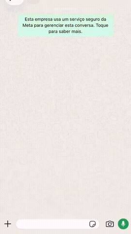
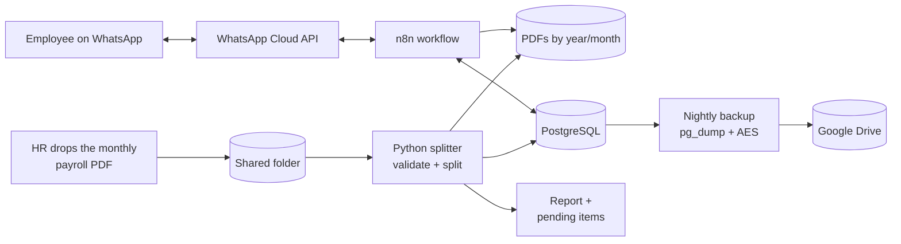

# 📄 WhatsApp HR Payslip Bot (n8n + PostgreSQL + Python)

> An end-to-end HR automation that lets ~180 employees of an agribusiness company request their own payslips on WhatsApp, 24/7, with identity verification, audit logging and zero manual work from the HR team.

**Author:** César Barth · [LinkedIn](https://www.linkedin.com/in/barthcesar07) · 2026
🇧🇷 [Versão em português abaixo](#-versão-em-português)

<p align="center">
  
  <br><sub>Full demo video: <a href="docs/demo.mp4">docs/demo.mp4</a> (test data only)</sub>
</p>

---

## The problem

Every month, HR received the payroll as **one single PDF with every employee's payslip** and had to split it, find each person and send it out by hand. Employees who needed an older payslip (for a loan, rental, etc.) had to ask HR again.

## The solution

Three pieces that work together, with no human in the loop:

1. **Payslip splitter (Python)**: HR drops the monthly PDF into a shared folder. A script that starts with Windows reads every page, identifies each payslip by the employee code in the header, validates it against the employee database, and files it as `holerites/YYYY/YYYY-MM/<code>_<type>.pdf`.
2. **WhatsApp chatbot (n8n)**: the employee messages the company number, is identified by phone, confirms identity with the first 5 digits of their CPF, and gets the PDF delivered right in the chat.
3. **Encrypted cloud backup (Python)**: every night the whole database (employees, payslip index, audit log and the n8n workflow itself) is dumped, encrypted with AES and sent to Google Drive.



## Features

**Chatbot (n8n)**
- Identifies the employee by phone number (handles Brazil's missing 9th digit)
- Identity check with the **first 5 digits of the CPF**; 3 wrong attempts **lock the number for 30 minutes**
- Options: *latest payslip*, *last 3*, or *pick a month* (`MM/YYYY`)
- Interactive WhatsApp buttons and a conversation state machine stored in PostgreSQL (sessions expire after 30 min)
- Unknown numbers can only reach a human at HR, so no documents ever leak to non-employees
- Ignores Meta's duplicate and delayed webhook retries, so it never answers twice
- **Audit trail (LGPD)**: every identity check, lock and payslip request is logged
- Friendly fallbacks: payslip not found, file unreadable, unsupported message type
- Load-tested with **50 simultaneous requests**

**Payslip splitter (Python)**
- Reads the payslip by **layout** (the "Código" header field), not by loose numbers in the text
- Validates every copy: numeric code, code exists, **name in PDF = name in database**, period and payroll type found, no duplicates
- Keeps one copy per document (handles two-copies-per-page layouts and mixed Monthly/Advance payrolls)
- Anything that fails validation goes to a **pending folder and is never published**, with a hint of the likely fix (e.g. "this name is registered under code 123")
- `--reprocessar-pendencias`: re-checks pending items after HR fixes the registry; copy → DB → delete, with rollback if the DB fails
- `--simular` dry-run mode, per-run text report, and a list of active employees with no payslip that month
- Safe to schedule every 10 minutes: exits in < 1 s when the folder is empty and waits for files that are still being copied

**Encrypted backup (Python)**
- Daily `pg_dump` run by Windows Task Scheduler
- **Encrypted before leaving the server** (Fernet/AES with a scrypt-derived key): without the password, the file is useless even in the cloud
- 7-day rotation (one copy per weekday), kept both locally and on Google Drive via rclone
- Atomic writes (temp file + replace), log file, non-zero exit code on failure
- `--restaurar` mode decrypts a backup and prints the `pg_restore` steps

## Tech stack

| Layer | Tools |
|---|---|
| Orchestration | n8n (webhooks, Code nodes in JavaScript, Switch/If, HTTP Request) |
| Messaging | WhatsApp Cloud API (Meta Graph API v23: messages, media upload, interactive buttons) |
| Database | PostgreSQL (CTEs, `ON CONFLICT` upserts, lateral joins) |
| PDF processing | Python 3, pdfplumber, pypdf |
| Backup | pg_dump, cryptography (Fernet/AES + scrypt), rclone, Google Drive |
| Infra | Windows Server, Task Scheduler, HTTPS domain for the webhook |

## Repository structure

```
n8n/chatbot-rh-workflow.json   n8n workflow (credentials removed)
extractor/separar_folha.py     payslip splitter
extractor/config.ini.example   configuration template
backup/backup_banco.py         encrypted daily backup to Google Drive
backup/backup.ini.example      backup configuration template
database/schema.sql            PostgreSQL tables
database/dados_exemplo.sql     fictitious sample data
docs/                          demo video and GIF
```

## How to run it

1. **Database**: create a PostgreSQL database and run `database/schema.sql` (and optionally `dados_exemplo.sql`).
2. **n8n**: import `n8n/chatbot-rh-workflow.json`, then create two credentials: *Postgres* and *Header Auth* (`Authorization: Bearer <your Meta permanent token>`). In the **Decidir Ação** node, set `EMPRESA` and `RH_WHATSAPP`.
3. **Meta**: in your WhatsApp Business app, point the webhook to `https://<your-domain>/webhook/chatbot-rh` and subscribe to `messages`.
4. **Splitter**: `pip install -r extractor/requirements.txt`, copy `config.ini.example` to `config.ini`, fill it in, test with `python separar_folha.py --simular`, then schedule it in Windows Task Scheduler.
5. **Backup**: `pip install -r backup/requirements.txt`, install [rclone](https://rclone.org) and run `rclone config` to create your own Google Drive remote, copy `backup.ini.example` to `backup.ini`, then schedule `python backup_banco.py` once a day.

> All data in this repository and in the demo is fictitious. No real employee data, tokens or company information is included.

---

## 🇧🇷 Versão em português

**Chatbot de RH para envio de holerites pelo WhatsApp**, desenvolvido por mim para uma empresa do agronegócio com cerca de 180 colaboradores.

**O problema:** todo mês o RH recebia a folha em um único PDF com os holerites de todos e precisava separar e enviar um por um, manualmente.

**A solução:**
- **Separador em Python:** o RH coloca o PDF numa pasta compartilhada; o script, que inicia junto com o Windows, lê cada página pelo campo "Código" do cabeçalho, valida contra o cadastro (código, nome, competência, duplicidade) e salva cada holerite em pastas por ano e mês. O que não confere vai para pendências e nunca é publicado.
- **Chatbot no n8n:** o colaborador manda mensagem, é identificado pelo telefone, confirma os 5 primeiros dígitos do CPF (3 erros bloqueiam por 30 min) e recebe o PDF na hora: último holerite, últimos 3 ou um mês específico.
- **Backup criptografado:** todo dia o banco inteiro (cadastro, holerites, auditoria e o próprio n8n) é exportado, criptografado com AES e enviado ao Google Drive, com rotação de 7 dias.
- **Segurança e LGPD:** trilha de auditoria de todos os eventos, bloqueio por tentativas, números de fora da empresa só conseguem falar com o RH.

**Tecnologias:** n8n, WhatsApp Cloud API, PostgreSQL, Python (pdfplumber, pypdf, cryptography), rclone, Google Drive, Windows Server.

Todos os dados deste repositório e do vídeo são fictícios.
